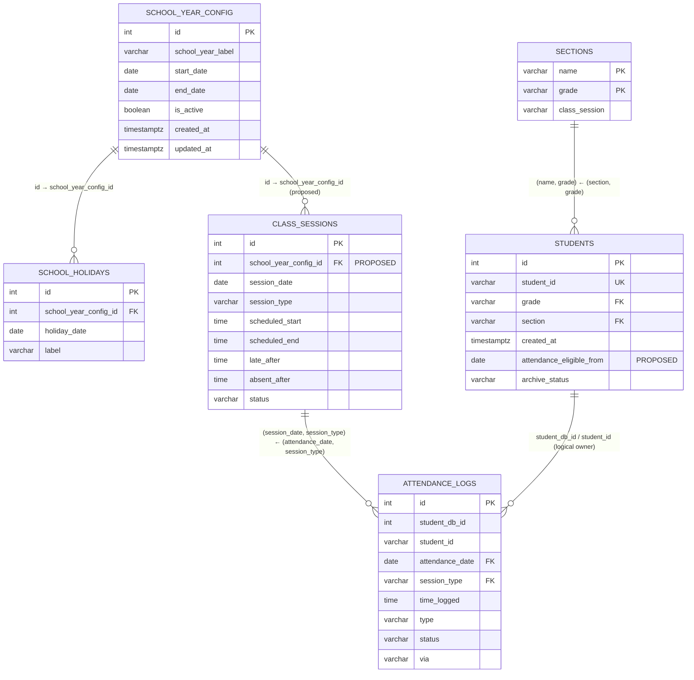

# School-Year Attendance ERD

This diagram documents the recommended attendance model. `school_year_config`
should be connected to `class_sessions`, not directly to every
`attendance_logs` row.

> **Status:** `school_year_config_id` on `class_sessions` is a proposed
> addition. Do not treat it as deployed until its migration has been reviewed
> and applied. The `attendance_logs → class_sessions` and
> `students → sections` relationships are already part of the integrity model.

## Why this structure is recommended

1. A school year defines the allowed date range for all of its class sessions.
2. A class session defines the actual morning or afternoon schedule and the
   absence cutoff for one calendar day.
3. An attendance log belongs to that class session. It does **not** need a
   duplicate school-year ID because the year is already available through the
   session.
4. A student should become eligible for automated attendance only on
   `attendance_eligible_from` (proposed). This prevents an import or manual
   registration late in the day from producing an immediate absence.

## Required attendance rules

The application/automation must reject or skip automatic attendance when:

- there is no active school year;
- the date is before `start_date` or after `end_date`;
- the date is a weekend or configured school holiday;
- no class session exists, or its `absent_after` cutoff has not passed;
- `attendance_date` is before the student's `attendance_eligible_from`.

Foreign keys protect identity and ownership. The date-range and cutoff rules
must remain application or database-trigger logic because a foreign key alone
cannot enforce a date being inside a parent row's start/end range.
