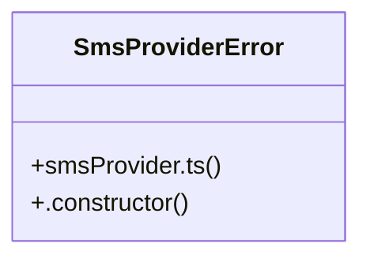

# Community 15

> 26 nodes · cohesion 0.11

## Key Concepts

- [sendSms()](file:///C:/Users/RENREN/Documents/Parentconnect/ParentConnect/parentconnect/src/lib/smsProvider.ts#L63) (10 connections)
- [attendanceSmsWorker.ts](file:///C:/Users/RENREN/Documents/Parentconnect/ParentConnect/parentconnect/src/lib/attendanceSmsWorker.ts#L1) (9 connections)
- [smsProvider.ts](file:///C:/Users/RENREN/Documents/Parentconnect/ParentConnect/parentconnect/src/lib/smsProvider.ts#L1) (8 connections)
- [deletionEmailQueue.ts](file:///C:/Users/RENREN/Documents/Parentconnect/ParentConnect/parentconnect/src/lib/deletionEmailQueue.ts#L1) (7 connections)
- [processJob()](file:///C:/Users/RENREN/Documents/Parentconnect/ParentConnect/parentconnect/src/lib/attendanceSmsWorker.ts#L61) (6 connections)
- [groupParentDeletionEmails()](file:///C:/Users/RENREN/Documents/Parentconnect/ParentConnect/parentconnect/src/lib/deletionEmailQueue.ts#L31) (6 connections)
- [processAttendanceSmsJobs()](file:///C:/Users/RENREN/Documents/Parentconnect/ParentConnect/parentconnect/src/lib/attendanceSmsWorker.ts#L104) (5 connections)
- [mapWithConcurrency()](file:///C:/Users/RENREN/Documents/Parentconnect/ParentConnect/parentconnect/src/lib/deletionEmailQueue.ts#L78) (5 connections)
- [claimJob()](file:///C:/Users/RENREN/Documents/Parentconnect/ParentConnect/parentconnect/src/lib/attendanceSmsWorker.ts#L31) (3 connections)
- [readResponse()](file:///C:/Users/RENREN/Documents/Parentconnect/ParentConnect/parentconnect/src/lib/smsProvider.ts#L27) (3 connections)
- [errorMessage()](file:///C:/Users/RENREN/Documents/Parentconnect/ParentConnect/parentconnect/src/lib/attendanceSmsWorker.ts#L21) (2 connections)
- [errorResponse()](file:///C:/Users/RENREN/Documents/Parentconnect/ParentConnect/parentconnect/src/lib/attendanceSmsWorker.ts#L25) (2 connections)
- [positiveInt()](file:///C:/Users/RENREN/Documents/Parentconnect/ParentConnect/parentconnect/src/lib/attendanceSmsWorker.ts#L16) (2 connections)
- [normalizeEmail()](file:///C:/Users/RENREN/Documents/Parentconnect/ParentConnect/parentconnect/src/lib/deletionEmailQueue.ts#L20) (2 connections)
- [configuredProvider()](file:///C:/Users/RENREN/Documents/Parentconnect/ParentConnect/parentconnect/src/lib/smsProvider.ts#L17) (2 connections)
- [e164()](file:///C:/Users/RENREN/Documents/Parentconnect/ParentConnect/parentconnect/src/lib/smsProvider.ts#L23) (2 connections)
- [errorForResponse()](file:///C:/Users/RENREN/Documents/Parentconnect/ParentConnect/parentconnect/src/lib/smsProvider.ts#L36) (2 connections)
- [semaphoreDetails()](file:///C:/Users/RENREN/Documents/Parentconnect/ParentConnect/parentconnect/src/lib/smsProvider.ts#L45) (2 connections)
- [SmsProviderError](file:///C:/Users/RENREN/Documents/Parentconnect/ParentConnect/parentconnect/src/lib/smsProvider.ts#L10) (2 connections)
- [unismsDetails()](file:///C:/Users/RENREN/Documents/Parentconnect/ParentConnect/parentconnect/src/lib/smsProvider.ts#L54) (2 connections)
- [DEFAULT_ATTENDANCE_SMS_BATCH_SIZE](file:///C:/Users/RENREN/Documents/Parentconnect/ParentConnect/parentconnect/src/lib/attendanceSmsWorker.ts#L12) (1 connections)
- [DEFAULT_ATTENDANCE_SMS_CONCURRENCY](file:///C:/Users/RENREN/Documents/Parentconnect/ParentConnect/parentconnect/src/lib/attendanceSmsWorker.ts#L13) (1 connections)
- [MAX_SMS_ATTEMPTS](file:///C:/Users/RENREN/Documents/Parentconnect/ParentConnect/parentconnect/src/lib/attendanceSmsWorker.ts#L14) (1 connections)
- [isValidEmail()](file:///C:/Users/RENREN/Documents/Parentconnect/ParentConnect/parentconnect/src/lib/deletionEmailQueue.ts#L24) (1 connections)
- [MAX_DELETION_EMAIL_ATTEMPTS](file:///C:/Users/RENREN/Documents/Parentconnect/ParentConnect/parentconnect/src/lib/deletionEmailQueue.ts#L1) (1 connections)
- *... and 1 more nodes in this community*

## Class Diagram

## Relationships

- No strong cross-community connections detected

## Source Files

- [C:\Users\RENREN\Documents\Parentconnect\ParentConnect\parentconnect\src\lib\attendanceSmsWorker.ts](file:///C:/Users/RENREN/Documents/Parentconnect/ParentConnect/parentconnect/src/lib/attendanceSmsWorker.ts)
- [C:\Users\RENREN\Documents\Parentconnect\ParentConnect\parentconnect\src\lib\deletionEmailQueue.ts](file:///C:/Users/RENREN/Documents/Parentconnect/ParentConnect/parentconnect/src/lib/deletionEmailQueue.ts)
- [C:\Users\RENREN\Documents\Parentconnect\ParentConnect\parentconnect\src\lib\smsProvider.ts](file:///C:/Users/RENREN/Documents/Parentconnect/ParentConnect/parentconnect/src/lib/smsProvider.ts)

## Audit Trail

- EXTRACTED: 70 (80%)
- INFERRED: 18 (20%)
- AMBIGUOUS: 0 (0%)

---

*Part of the graphify knowledge wiki. See [[index]] to navigate.*