# Knowledge Graph Index

> Auto-generated by graphify. Start here — read community articles for context, then drill into god nodes for detail.

**2211 nodes · 4113 edges · 49 communities**

---

## System Architecture Flowchart

```mermaid
flowchart TD
    C0["Community 0 (362 nodes)"]
    C1["Community 1 (305 nodes)"]
    C2["Community 2 (252 nodes)"]
    C3["Community 3 (225 nodes)"]
    C4["Community 4 (151 nodes)"]
    C5["Community 5 (131 nodes)"]
    C6["Community 6 (123 nodes)"]
    C7["Community 7 (81 nodes)"]
    C8["Community 8 (80 nodes)"]
    C9["Community 9 (76 nodes)"]
    C10["Community 10 (59 nodes)"]
    C11["Community 11 (55 nodes)"]
    C12["Community 12 (43 nodes)"]
    C13["Community 13 (42 nodes)"]
    C14["Community 14 (38 nodes)"]
    C15["Community 15 (26 nodes)"]
    C16["Community 16 (26 nodes)"]
    C17["Community 17 (15 nodes)"]
    C18["Community 18 (14 nodes)"]
    C19["Community 19 (13 nodes)"]
    C20["Community 20 (12 nodes)"]
    C21["Community 21 (9 nodes)"]
    C22["Community 22 (8 nodes)"]
    C23["Community 23 (8 nodes)"]
    C24["Community 24 (5 nodes)"]
    C25["Community 25 (4 nodes)"]
    C26["Community 26 (4 nodes)"]
    C27["Community 27 (3 nodes)"]
    C28["Community 28 (3 nodes)"]
    C29["Community 29 (3 nodes)"]
    C30["Community 30 (2 nodes)"]
    C31["Community 31 (2 nodes)"]
    C32["Community 32 (2 nodes)"]
    C33["Community 33 (2 nodes)"]
    C34["Community 34 (2 nodes)"]
    C35["Community 35 (2 nodes)"]
    C36["Community 36 (2 nodes)"]
    C37["Community 37 (2 nodes)"]
    C38["Community 38 (2 nodes)"]
    C39["Community 39 (2 nodes)"]
    C40["Community 40 (2 nodes)"]
    C41["Community 41 (2 nodes)"]
    C42["Community 42 (2 nodes)"]
    C43["Community 43 (2 nodes)"]
    C44["Community 44 (2 nodes)"]
    C45["Community 45 (2 nodes)"]
    C46["Community 46 (1 nodes)"]
    C47["Community 47 (1 nodes)"]
    C48["Community 48 (1 nodes)"]
    C0 -->|54 edges| C8
    C10 -->|53 edges| C1
    C0 -->|29 edges| C5
    C4 -->|22 edges| C2
    C2 -->|16 edges| C1
    C8 -->|15 edges| C0
    C4 -->|15 edges| C6
    C6 -->|13 edges| C2
    C4 -->|13 edges| C1
    C0 -->|12 edges| C16
    C2 -->|10 edges| C5
    C5 -->|9 edges| C1
    C0 -->|9 edges| C15
    C3 -->|9 edges| C2
    C3 -->|9 edges| C8
    C3 -->|9 edges| C5
    C10 -->|9 edges| C4
    C0 -->|8 edges| C18
    C3 -->|8 edges| C4
    C10 -->|8 edges| C2
    C9 -->|8 edges| C1
    C7 -->|8 edges| C2
    C3 -->|7 edges| C1
    C4 -->|7 edges| C3
    C8 -->|7 edges| C1
    C2 -->|7 edges| C3
    C5 -->|6 edges| C0
    C4 -->|6 edges| C10
    C2 -->|6 edges| C6
    C10 -->|6 edges| C9
    C10 -->|6 edges| C8
    C1 -->|6 edges| C5
    C4 -->|5 edges| C7
    C4 -->|5 edges| C9
    C1 -->|5 edges| C2
    C10 -->|5 edges| C0
    C10 -->|5 edges| C6
    C10 -->|5 edges| C5
    C4 -->|5 edges| C5
    C1 -->|5 edges| C8
    C1 -->|5 edges| C0
    C1 -->|5 edges| C4
    C1 -->|5 edges| C10
    C2 -->|5 edges| C7
    C7 -->|5 edges| C4
    C5 -->|5 edges| C6
    C2 -->|4 edges| C9
    C6 -->|4 edges| C5
    C7 -->|4 edges| C3
    C2 -->|4 edges| C4
    C5 -->|4 edges| C4
    C5 -->|4 edges| C2
    C0 -->|3 edges| C3
    C0 -->|3 edges| C22
    C3 -->|3 edges| C0
    C3 -->|3 edges| C9
    C2 -->|3 edges| C8
    C8 -->|3 edges| C3
    C8 -->|3 edges| C2
    C10 -->|3 edges| C3
    C6 -->|3 edges| C7
    C1 -->|3 edges| C7
    C1 -->|3 edges| C9
    C8 -->|3 edges| C4
    C8 -->|3 edges| C5
    C7 -->|3 edges| C9
    C5 -->|3 edges| C7
    C15 -->|3 edges| C0
    C13 -->|2 edges| C3
    C0 -->|2 edges| C20
    C0 -->|2 edges| C23
    C0 -->|2 edges| C2
    C0 -->|2 edges| C1
    C8 -->|2 edges| C15
    C8 -->|2 edges| C20
    C3 -->|2 edges| C6
    C8 -->|2 edges| C16
    C1 -->|2 edges| C3
    C6 -->|2 edges| C4
    C8 -->|2 edges| C7
    C8 -->|2 edges| C11
    C7 -->|2 edges| C5
    C5 -->|2 edges| C11
    C5 -->|2 edges| C14
    C5 -->|2 edges| C16
    C2 -->|2 edges| C0
    C7 -->|2 edges| C1
    C5 -->|2 edges| C15
    C21 -->|1 edges| C3
    C13 -->|1 edges| C5
    C13 -->|1 edges| C0
    C0 -->|1 edges| C7
    C23 -->|1 edges| C0
    C0 -->|1 edges| C4
    C3 -->|1 edges| C10
    C3 -->|1 edges| C7
    C6 -->|1 edges| C9
    C11 -->|1 edges| C8
    C10 -->|1 edges| C7
    C4 -->|1 edges| C8
    C4 -->|1 edges| C19
    C4 -->|1 edges| C11
    C1 -->|1 edges| C6
    C8 -->|1 edges| C12
    C8 -->|1 edges| C14
    C8 -->|1 edges| C9
    C8 -->|1 edges| C6
    C8 -->|1 edges| C22
    C5 -->|1 edges| C3
    C12 -->|1 edges| C8
    C12 -->|1 edges| C5
    C7 -->|1 edges| C6
    C5 -->|1 edges| C9
    C5 -->|1 edges| C8
    C9 -->|1 edges| C7
    C14 -->|1 edges| C11
    C14 -->|1 edges| C0
    C9 -->|1 edges| C0
    C5 -->|1 edges| C22
    C22 -->|1 edges| C0
```

## Communities
(sorted by size, largest first)

- [[Community 0]] — 362 nodes
- [[Community 1]] — 305 nodes
- [[Community 2]] — 252 nodes
- [[Community 3]] — 225 nodes
- [[Community 4]] — 151 nodes
- [[Community 5]] — 131 nodes
- [[Community 6]] — 123 nodes
- [[Community 7]] — 81 nodes
- [[Community 8]] — 80 nodes
- [[Community 9]] — 76 nodes
- [[Community 10]] — 59 nodes
- [[Community 11]] — 55 nodes
- [[Community 12]] — 43 nodes
- [[Community 13]] — 42 nodes
- [[Community 14]] — 38 nodes
- [[Community 15]] — 26 nodes
- [[Community 16]] — 26 nodes
- [[Community 17]] — 15 nodes
- [[Community 18]] — 14 nodes
- [[Community 19]] — 13 nodes
- [[Community 20]] — 12 nodes
- [[Community 21]] — 9 nodes
- [[Community 22]] — 8 nodes
- [[Community 23]] — 8 nodes
- [[Community 24]] — 5 nodes
- [[Community 25]] — 4 nodes
- [[Community 26]] — 4 nodes
- [[Community 27]] — 3 nodes
- [[Community 28]] — 3 nodes
- [[Community 29]] — 3 nodes
- [[Community 30]] — 2 nodes
- [[Community 31]] — 2 nodes
- [[Community 32]] — 2 nodes
- [[Community 33]] — 2 nodes
- [[Community 34]] — 2 nodes
- [[Community 35]] — 2 nodes
- [[Community 36]] — 2 nodes
- [[Community 37]] — 2 nodes
- [[Community 38]] — 2 nodes
- [[Community 39]] — 2 nodes
- [[Community 40]] — 2 nodes
- [[Community 41]] — 2 nodes
- [[Community 42]] — 2 nodes
- [[Community 43]] — 2 nodes
- [[Community 44]] — 2 nodes
- [[Community 45]] — 2 nodes
- [[Community 46]] — 1 nodes
- [[Community 47]] — 1 nodes
- [[Community 48]] — 1 nodes

## God Nodes
(most connected concepts — the load-bearing abstractions)

- [[POST()]] — 189 connections
- [[GET()]] — 149 connections
- [[PATCH()]] — 100 connections
- [[json]] — 99 connections
- [[map]] — 95 connections
- [[from]] — 68 connections
- [[errorMessage()]] — 36 connections
- [[SECRET]] — 28 connections
- [[[loading,   setLoading]]] — 28 connections
- [[DELETE()]] — 24 connections

---

*Generated by [graphify](https://github.com/safishamsi/graphify)*